# Real Scout

A bilingual (English / Arabic) real estate browsing app built in Flutter from the
"Real Scout" Figma design. Listings come from the public
[DummyJSON](https://dummyjson.com) API. The layout mirrors fully between LTR and
RTL, and the app ships with three color palettes that can be switched at runtime.

<p align="center">
  
</p>

The full-quality recording is in [`docs/demo.mp4`](docs/demo.mp4).

## Screens

| | English | Arabic |
|---|---|---|
| Splash | 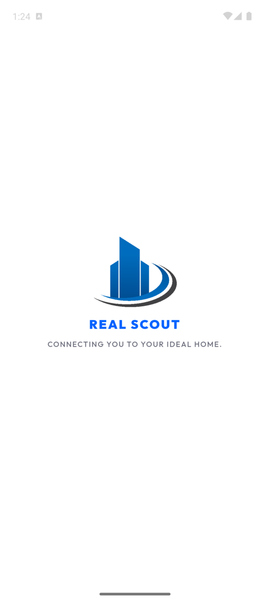 | 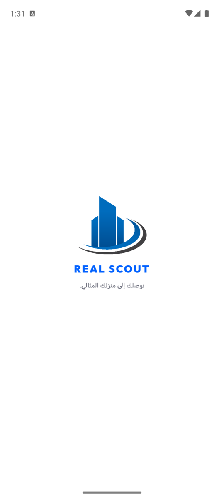 |
| Sign in | 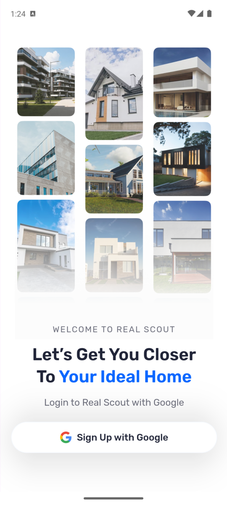 | 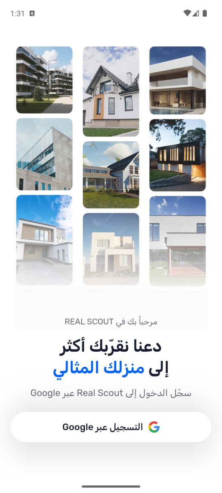 |
| Home | 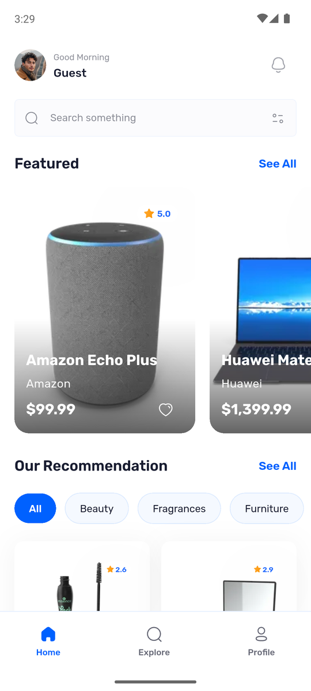 | 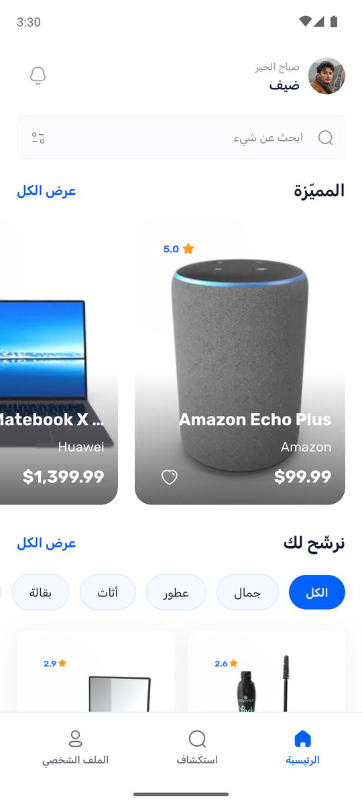 |
| Explore (list) | 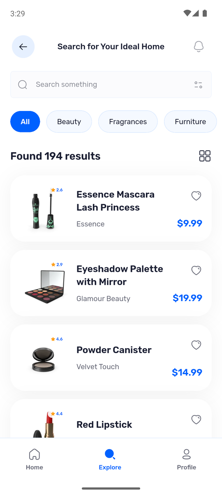 | 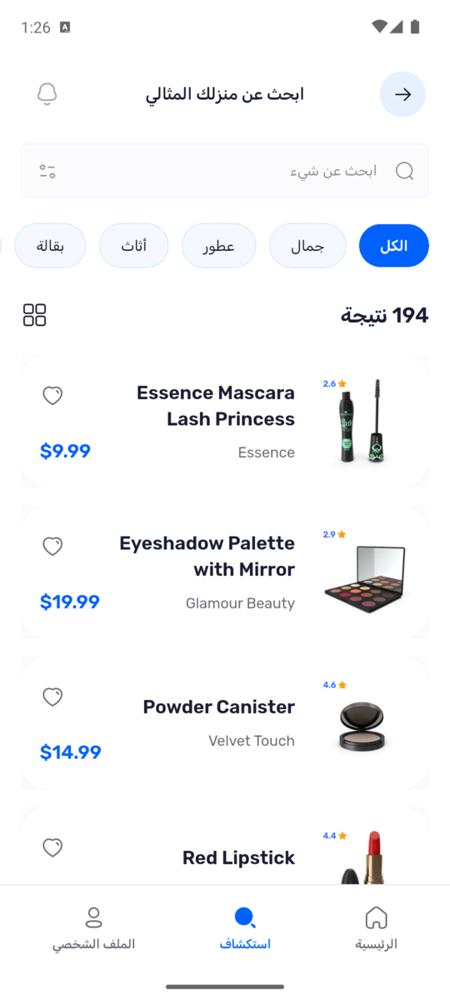 |
| Explore (grid) | 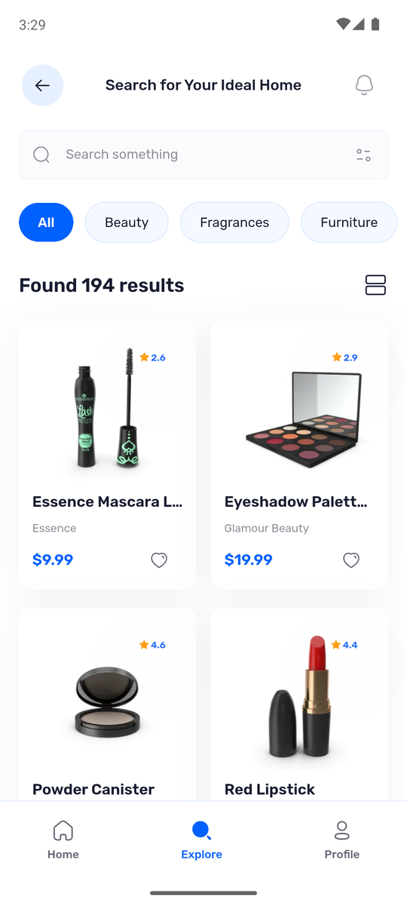 | 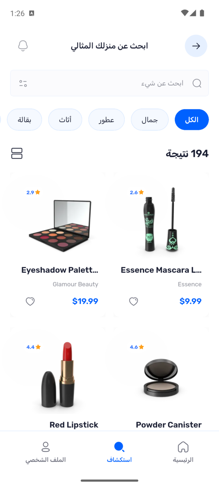 |
| Filters | 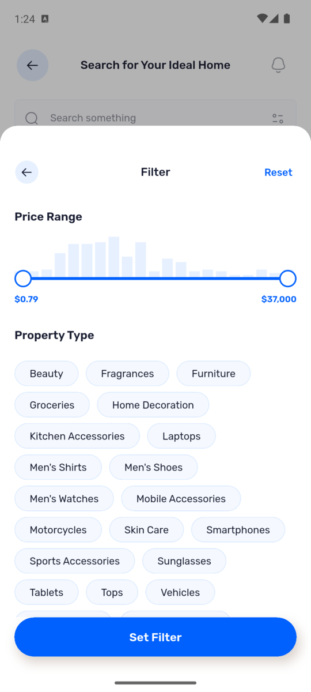 | 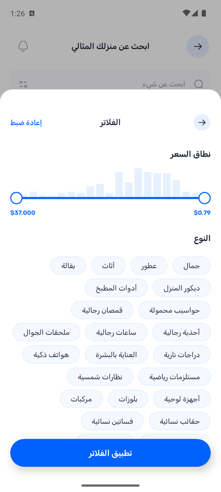 |
| Details | 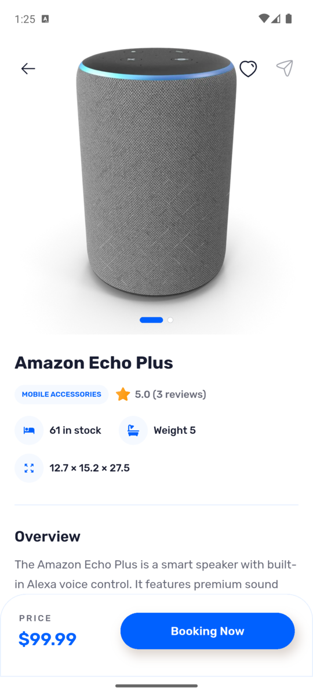 | 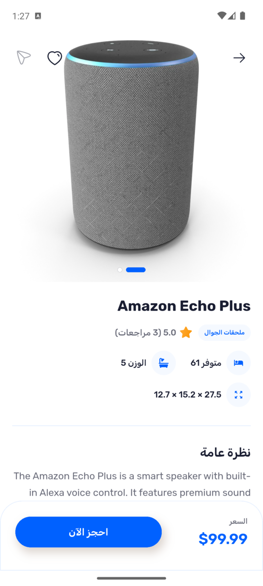 |
| Profile | 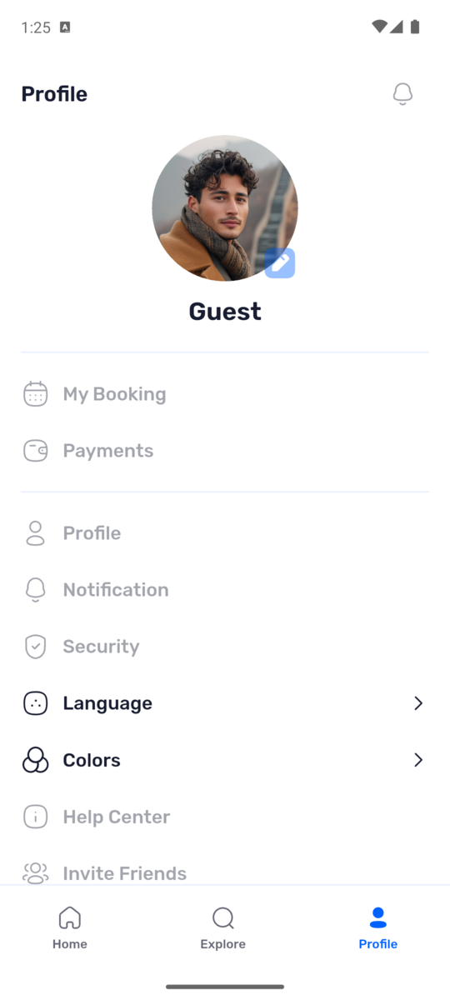 |  |

The other two palettes (purple in English, orange in Arabic):

| Home | Details |
|---|---|
| 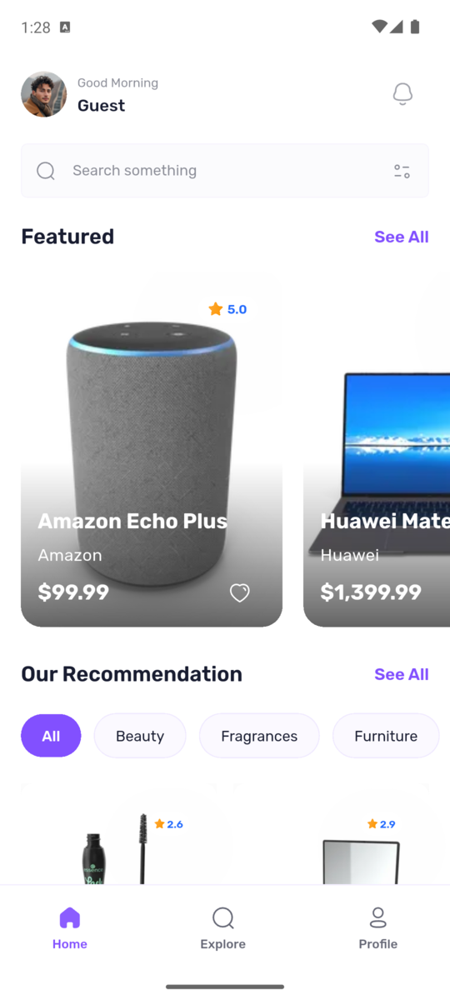 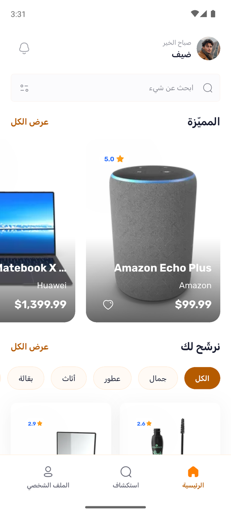 | 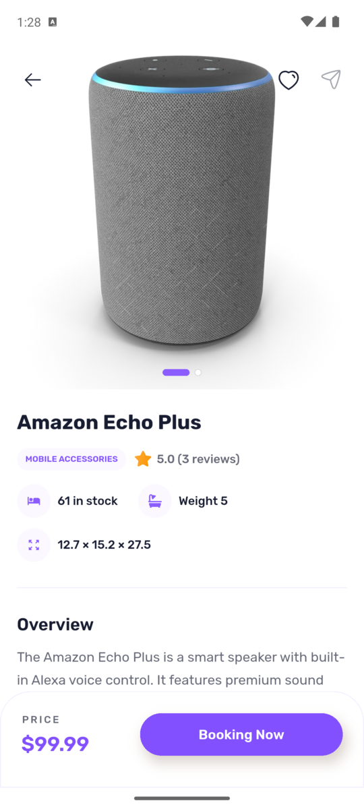 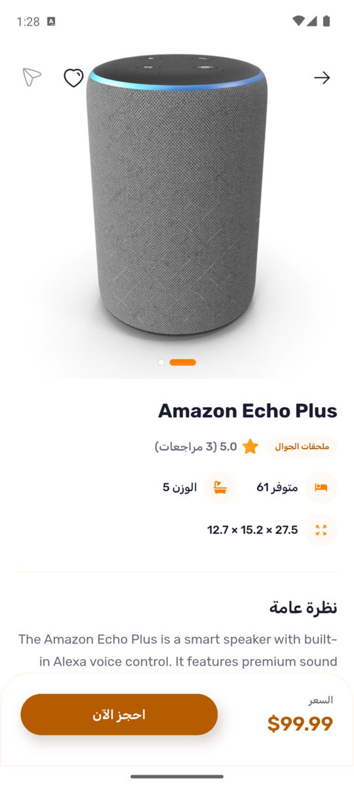 |

All screenshots are taken from a release build on a Pixel 6 emulator (Android 13).

## Requirements

| Tool | Version |
|---|---|
| Flutter | 3.50.1 (stable) |
| Dart | 3.14.0 |
| Android | minSdk / targetSdk from Flutter 3.50 defaults |
| iOS | configured (`Info.plist`), not run on a device or simulator |

Flutter 3.50 deprecates `package:flutter/material.dart` in favor of the
separate `material_ui` package, so every import in `lib/` and `test/` uses
`package:material_ui/material_ui.dart`.

## Getting started

```sh
git clone https://github.com/TAREK-SY/real_estate.git
cd real_estate
flutter pub get
flutter run
```

### API base URL

The app talks to `https://dummyjson.com` by default. Point it at another host
(for example a local mock server) without touching the code:

```sh
flutter run --dart-define=API_BASE_URL=https://dummyjson.com
```

The value is checked at startup: anything that is not an absolute `http(s)` URL
fails an assert immediately instead of failing every request later
(`lib/core/config/app_config.dart`).

### Release build

```sh
flutter build apk --release
```

The launcher icon is generated from the logo; the source images and the
command are in `assets/icon/` and `flutter_launcher_icons.yaml`.

### Git hook

A pre-push hook runs the same three gates as below and refuses to push a dirty
tree or a branch that is not `HEAD`. Enable it once per clone:

```sh
git config core.hooksPath .githooks
```

## Tests

```sh
dart format --output=none --set-exit-if-changed .
flutter analyze
flutter test --coverage
```

480 tests, 99.5% line coverage. The suite covers:

- **Unit:** JSON parsing against real-shaped fixtures, the HTTP layer (offline,
  timeout, 4xx/5xx, malformed bodies), the query cache, pagination, the filter
  model, every controller, routes, translation keys (both files have the same
  keys) and palette contrast ratios.
- **Widget:** every screen in its loading, success, empty and error states,
  broken images, very long titles, RTL placement, and the three palettes.
- **Screen-size matrix:** every screen in both languages at 320x568, 360x640,
  393x852, 430x932 (design), 932x430 and 800x1280, failing on any overflow.
- **Accessibility:** Flutter's tap-target, label and contrast guidelines. On
  the main tabs the automatic contrast check samples colors from the wrong
  place inside nested scroll views, so there the text colors are checked
  against their backgrounds directly, per palette.
- **Journeys:** first launch to Home, search and filter, and
  listing → favorite → back → profile → language → palette → logout.
- **Architecture guards:** no widget state in controllers, cleanup in
  `onClose`, no `Get.put` in views, no `Color(0x...)` outside the palette file,
  no hard-coded left/right in layout code, no invisible bidi characters, and no
  imports of the deprecated material library.

## Architecture

```
lib/
├── bindings/        GetX bindings: one per route, plus app-wide services
├── controller/      state and logic, one folder per feature
├── core/
│   ├── class/       Crud (HTTP pipeline), QueryCache, StatusRequest, HandlingDataView
│   ├── config/      AppConfig (API_BASE_URL)
│   ├── constant/    asset paths, widget keys, fonts
│   ├── functions/   JSON parsers, price formatter, status messages, time helpers
│   ├── localization/ AppStrings (translation keys), category names
│   ├── middleware/  unknown-route fallback, main-route scope
│   ├── services/    SharedPreferences service, session store
│   ├── shared/      app-wide widgets (buttons, images, LTR text)
│   ├── theme/       AppPalette, text styles, ThemeData
│   └── util/        design size and scaling helpers
├── data/
│   ├── datasource/remote/  one class per API area
│   └── model/       Product, Category, Review, query and filter models
├── view/
│   ├── screen/      one file per screen (main/ holds the three tabs)
│   └── widget/      reusable widgets (cards, chips, filter sheet, details parts)
├── link_api.dart    every endpoint in one place
├── routes.dart      route names and pages
└── main.dart
```

The flow is always **datasource → controller → view**. Widgets never call the
network; they read controller state and render one of the states produced by
`HandlingDataView`. Repeated UI (property cards in three layouts, chips,
section headers, circular icon buttons, bottom sheets) lives in `view/widget/`
and is shared between screens.

### State management: GetX

GetX gives dependency injection, routing and reactive state in one package,
and `Bindings` tie a controller's lifetime to its route. The rules followed
throughout the code:

- controllers hold no widget state (`TextEditingController`, `FocusNode` and
  `ScrollController` live in the widgets);
- cleanup in `onClose()`, navigation in `onReady()`, no `Get.put` in `build`;
- every route has a named constant and a binding, checked by `app_route_test`;
- unknown routes land on a "not found" screen through a middleware;
- controllers that must outlive a single screen (the main shell and its tabs)
  are permanent and are removed when the user signs out.

Riverpod (compile-time safety) and Bloc (more ceremony than this app needs)
were the alternatives considered.

### Networking

`Crud` runs every request through one pipeline: connectivity check → request
with a timeout → JSON decode → classification. It returns
`Either<StatusRequest, ApiResult>`, so every failure is a typed state
(offline, timeout, not found, server error, unexpected response), and each
state has a translated message and, where it makes sense, a retry button. The
HTTP client and the connectivity check are injected, so tests run against
`MockClient`.

Requests are not repeated without reason:

- `QueryCache` keeps each GET result for 5 minutes, keyed by the full URL, and
  identical requests in flight share one future;
- search input is debounced, and a stale response is dropped when a newer
  query has started;
- lists page with `limit` / `skip`, and a failed "load more" stops until the
  user taps retry.

### Packages

| Package | Why |
|---|---|
| `get` | state, dependency injection and routing (see above) |
| `easy_localization` | JSON translation files, runtime locale switch, plural rules for Arabic |
| `flutter_screenutil` | design values are written as in Figma (430x932) and scaled to the screen |
| `http` | small HTTP client; nothing here needs interceptors (so no `dio`) |
| `either_dart` | typed success/failure results from the network layer |
| `shared_preferences` | language, palette, favorites and the guest session (small, non-sensitive) |
| `cached_network_image` | image caching with a placeholder and an error widget |
| `flutter_svg` | the Iconly icons exported from the design as SVG |
| `iconsax_flutter` | the vuesax icons used in the design |
| `intl` | price formatting |
| `material_ui` | Material widgets (replaces the deprecated `flutter/material.dart`) |

Dev: `mocktail` (mocks), `fake_async` (debounce and timeout tests),
`flutter_cache_manager` (offline image cache in tests), `flutter_lints`.

## Language and RTL

- The language is switched from **Profile → Language**. The switch is
  immediate (no restart), it is saved, and it is restored on the next launch.
  The first launch follows the device language when it is Arabic or English.
- `easy_localization` drives the locale and GetX follows it, so there is a
  single source of truth.
- Every visible string goes through `AppStrings` keys present in both
  `assets/l10n/en.json` and `assets/l10n/ar.json`; a test fails if a key is
  missing in either file.
- Layout code uses directional APIs only (`EdgeInsetsDirectional`,
  `PositionedDirectional`, `AlignmentDirectional`, start/end), so the whole UI
  mirrors in Arabic. Directional icons (back arrows, chevrons) use
  `matchTextDirection`.
- Mixed content: prices, numbers and Latin product names inside Arabic text are
  wrapped in an LTR island (`LtrText`), so `$1,899.99` and English titles read
  correctly. Prices use Western digits and `$` in both languages.
- Arabic text uses Rubik with no letter spacing (spacing breaks connected
  Arabic letters); the design's Latin display fonts (Outfit, Inter) are used
  for English only.

## Color palettes

On top of the design's original blue palette, the app has the two variants
from the design file, "New Purple" and "New Orange", switched from
**Profile → Colors**. The change applies immediately and is saved.

All colors come from one `ThemeExtension<AppPalette>` read through
`context.palette`; there are no color literals outside
`lib/core/theme/app_palette.dart` (enforced by a test). The Splash logo has one
SVG per palette because its gradient changes with the palette.

The purple and orange primaries are too light for white text (4.11:1 and
2.52:1). Text on or in the primary color uses a darker shade of the same hue
(at least 4.5:1, WCAG AA) while icons, sliders and borders keep the design
color. A test checks the ratios for every palette.

## AI usage summary

Claude Code helped with the fonts, the translation keys (with
`easy_localization`, which I chose), the data and network layers, the tests,
screen-size checks, code comments, the `docs/` media, the README, the commits
and code review. The details, example instructions, how the output was
verified, what was changed or rejected, and the differences from the design
are in [AI_USAGE.md](AI_USAGE.md).

## Assumptions and known limitations

- **DummyJSON does not store writes.** "Booking Now" sends a real
  `POST /carts/add`, and the app says right away that nothing is saved. Nothing
  in the UI claims that a booking persists.
- **No real authentication.** The design has a single "Continue with Google"
  button; it starts a local guest session and says that Google sign-in is not
  connected. Logout ends that session.
- **Products as listings.** DummyJSON serves products, not properties, so each
  design field is mapped to a real API field instead of invented data:
  location → `brand` (or the category), rating → `rating`, the three Details
  features → `stock`, `weight` and `dimensions` (shown without units because
  the API gives none), facilities → `tags`, reviews → `reviews`. The agent and
  map sections are left out because the API has nothing behind them.
- **Filters.** The API cannot filter by price or weight, search within a
  category, or request several categories at once. Search alone or a single
  category is paged by the server; any other combination loads the catalogue
  once (194 items, selected fields only, cached) and filters on the device.
  The "Details" and "Building Size" filter groups from the design filter by
  minimum rating, minimum stock and weight. Prices use a logarithmic scale
  because they range from $0.79 to $36,999.
- **Controls with no backing feature** (notifications, share, profile items
  such as payments or security, editing the photo) are shown dimmed and
  disabled instead of pretending to work.
- **Favorites are local** to the device. If saving fails, the heart reverts
  and a message says so.
- **Portrait only.** Font sizes scale with the screen width as in the design,
  so the app is locked upright. iPad keeps all orientations because iPadOS
  multitasking requires it, and Android 16 ignores the lock on large screens.
- **Search hint contrast** follows the design (3.2:1, below 4.5:1).
- **iOS** is configured but was not run: there was no macOS machine available.
